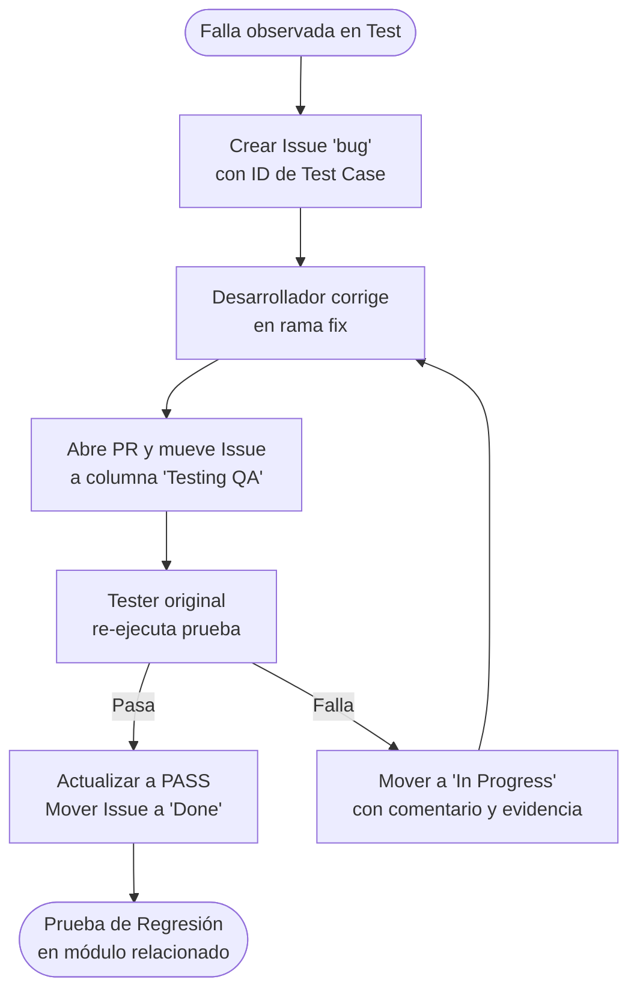
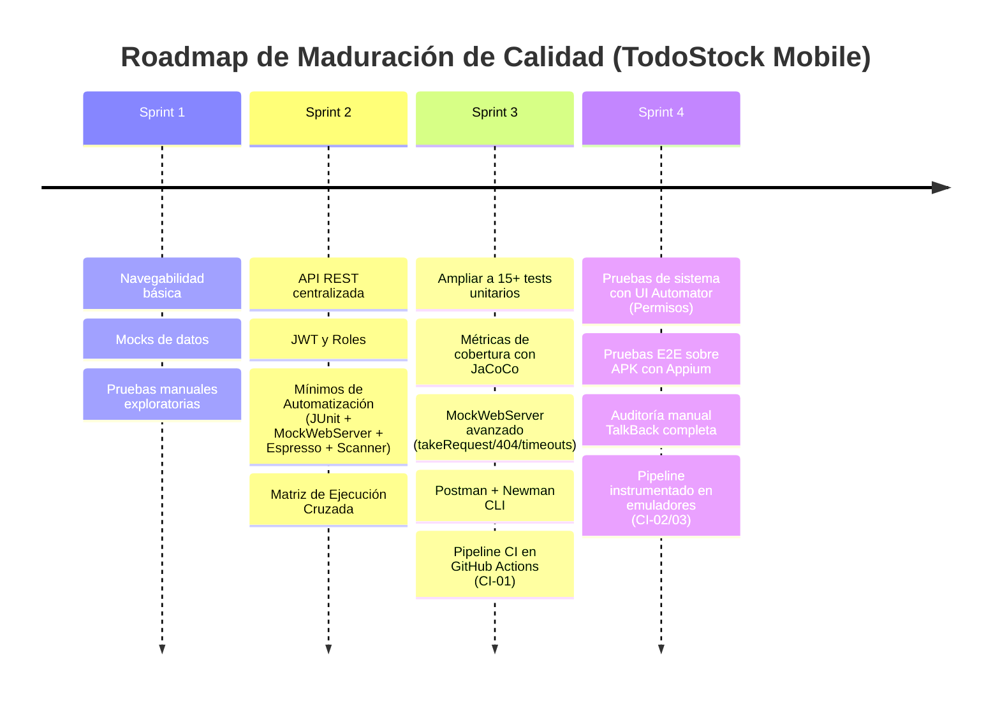

# Plan de Pruebas Integral de Software (IEEE 829)
## TodoStock Mobile — Sistema de Gestión de Inventarios

> **Documento:** Plan de Pruebas Integral de Software (Master Test Plan)  
> **Identificador:** `PDP-TODOSTOCK-01`  
> **Estándar:** Adaptación de IEEE 829-2008 / ISO/IEC/IEEE 29119 e ISTQB  
> **Proyecto:** TodoStock App Móvil — ISPC 2026 (Proyecto Integrador ABP II)  
> **Repositorio Oficial:** [ISPC-WEB-2025/TodoStock-AppMovil](https://github.com/ISPC-WEB-2025/TodoStock-AppMovil)  
> **Backend Centralizado:** Django REST Framework (`https://todostock.alwaysdata.net/api/`)  
> **Responsable de QA / Autor del Plan:** Miguel Flores (@mikefink22)  
> **Rama de Trabajo:** `feature/miguel_flores-TK80`  
> **Issue Asociada:** [#69 [ENABLER-QA] Suite de pruebas automatizadas, pipeline CI/CD e informe de accesibilidad](https://github.com/ISPC-WEB-2025/TodoStock-AppMovil/issues/69)  
> **Épica de Automatización:** [#200 [MIN-AUT] Mínimos de automatización Sprint 2](https://github.com/ISPC-WEB-2025/TodoStock-AppMovil/issues/200)

---

## Control de Versiones

| Versión | Fecha | Autor / Responsable | Descripción de Cambios |
| :---: | :---: | :---: | :--- |
| **v1.0** | 15/09/2026 | Equipo TodoStock | **Línea base Sprint 1:** Planificación de pruebas iniciales de navegabilidad de Activities, validación de formularios aislados (datos mock) y casos de prueba manuales. |
| **v2.0** | 11/10/2026 | Miguel Flores (@mikefink22) | **Incremento Integral Sprint 2:** Formalización bajo estándar IEEE 829. Incorporación de conexión real con API REST Alwaysdata, autenticación JWT y control por roles, cobertura integral del módulo Registro (validaciones robustas, DNI y edad mínima 18 años), incorporación de la suite de Mínimos de Automatización (`AUT-UNIT`, `AUT-NET`, `AUT-UI`, `ACC`), protocolo formal de ciclo de vida de defectos y nueva **Matriz de Ejecución Cruzada reasignada** (nadie ejecuta su propio código). |
| **v3.0** | *Roadmap* | Equipo TodoStock | **Planificación Sprints 3 y 4:** Ampliación a 15+ tests unitarios con JaCoCo, integración MockWebServer avanzada (`takeRequest`, timeouts), Postman + Newman en CI/CD, Espresso con Idling Resources, UI Automator y pruebas E2E con Appium. |

---

## 1. Introducción y Propósito

El presente documento constituye el **Plan de Pruebas Integral (Master Test Plan)** para la aplicación móvil **TodoStock Mobile**, desarrollada en Android nativo (Java) consumiendo una arquitectura backend centralizada en Django REST Framework.

El objetivo principal de este plan es establecer el marco metodológico, los niveles de prueba, el alcance funcional y no funcional, los criterios de aceptación y suspensión, la matriz de riesgos y la asignación operativa de recursos para verificar y validar de forma continua el incremento del producto a lo largo de los **Sprints 0, 1, 2 (en curso activo) y posteriores (Sprints 3 y 4)**.

### Ecosistema Documental de Calidad
Para garantizar una gestión ágil y profesional, el ecosistema de QA se divide en tres componentes interconectados:
1. **Plan de Pruebas (`docs/PLAN_DE_PRUEBAS.md` / Este documento):** Marco rector estratégico (el qué, por qué, cómo, quién y bajo qué criterios se prueba).
2. **Planilla de Casos de Prueba (Google Sheets / [Testing-y-Calidad](https://github.com/ISPC-WEB-2025/TodoStock-AppMovil/wiki/Testing-y-Calidad)):** Especificación operativa paso a paso de cada caso de prueba (`TC-XX-##`) y registro/log de evidencias de ejecución.
3. **Tablero Kanban y Wiki de GitHub:** Monitoreo dinámico del avance del sprint, seguimiento de historias de usuario y trazabilidad del ciclo de vida de los bugs reportados.

> **Aclaración sobre Plantilla Base del Proyecto:** La pestaña histórica denominada *"Ejemplo Test Case Asistencia Te..."* presente en la planilla compartida corresponde a la plantilla de referencia didáctica provista inicialmente por la cátedra como punto de partida. En el proceso de maduración técnica del equipo hacia el Sprint 2, dicha referencia fue completamente superada y sustituida por las pestañas modulares del proyecto (Login, Registro, Movimientos, Sucursales, Productos, Stock, Contacto y Seguridad), las cuales adoptan la nomenclatura formal unificada (`TC-XX-##`) y trazabilidad estricta a las Historias de Usuario.

---

## 2. Alcance de las Pruebas (Test Scope)

El alcance se estructura de forma evolutiva e incremental cubriendo el ciclo de vida completo del desarrollo:

```
[Sprint 0 & 1: Mocks y Navegación] ──▶ [Sprint 2: API Real, JWT, Registro y Mínimos Automatización] ──▶ [Sprints 3 & 4: CI/CD, E2E y Cobertura]
```

### 2.1 Elementos dentro del Alcance (In-Scope)

#### A. Sprint 0 y Sprint 1 (Línea Base Histórica)
* Validación de navegabilidad entre Activities y coherencia de retorno al presionar el botón *"Atrás"*.
* Formularios funcionales con validaciones locales y datos mock (Login sin API, Selección de Sucursales mock, Movimientos en memoria).
* Pruebas exploratorias y de usabilidad en dispositivos físicos y emuladores.

#### B. Sprint 2 (Ciclo Activo en Ejecución — Cierre 13/10)
* **Autenticación y Menú por Roles (US01 / #55):**
  * Login contra API REST (`POST /api/usuarios/login/`) recibiendo Access y Refresh JWT.
  * Almacenamiento seguro del token en `EncryptedSharedPreferences` (`SesionManager`).
  * Inyección automática del header `Authorization: Bearer <token>` mediante `AuthInterceptor`.
  * Diferenciación de vistas en Menú Principal según rol (`Administrador` vs. `Empleado`).
  * Cierre de sesión seguro con invalidación de estado local y borrado de tokens.
* **Selección de Sucursal y Persistencia (US02 / #56):**
  * Consumo del listado real desde la API (`GET /api/sucursales/`).
  * Traspaso del ID de sucursal activa vía `Intent` hacia las pantallas dependientes.
* **Consulta de Stock y Alerta Visual (US03 / #57):**
  * Listado de stock en tiempo real por sucursal seleccionada (`GET /api/stock/?sucursal_id=X`).
  * Detección visual y resaltado de productos que se encuentren por debajo del umbral mínimo de existencia.
* **Formulario de Contacto y Soporte (US04 / #58):**
  * Envío de mensajes de soporte vinculados a la API (`POST /api/contacto/`).
* **Gestión y Catálogo de Productos (US05 & US09 / #59, #63):**
  * Alta de productos contra la API (restringida a Administradores).
  * Validación de unicidad de código de producto y campos obligatorios.
* **Movimientos de Stock Atómicos (US06 / #60):**
  * Registro transaccional entre sucursales (`POST /api/movimientos/`).
  * Validaciones de negocio: sucursal origen distinta a destino, producto seleccionado y cantidad estrictamente entera mayor a cero (`> 0`).
* **Registro de Usuarios y Reglas de Negocio (US07 / #61):**
  * Alta de cuenta en estado `Pendiente de aprobación` (`POST /api/usuarios/registro/`).
  * Validaciones de cliente y servidor: nombre válido (mínimo 6 caracteres), email corporativo no duplicado, DNI numérico válido (7 u 8 dígitos).
  * Política de contraseñas robustas: mínimo 9 caracteres, combinando letras, números y caracteres especiales sin espacios.
  * **Regla de Edad Mínima (#221):** Validación estricta que exige ser mayor o igual a 18 años para solicitar cuenta.
* **Legislación y Protección de Datos Personales (US11 / #67):**
  * Lectura y aceptación obligatoria de Términos y Condiciones y Política de Privacidad antes del registro.
  * Funcionalidad de autoservicio *"Darme de baja"* (`DELETE /api/usuarios/me/`) con confirmación modal y deslogueo.
* **Ciberseguridad y Auditoría (RNF-SEG / #68):**
  * Casos de prueba `TC-SEG-01` a `TC-SEG-05`: expiración de sesión, fortaleza de contraseñas, control de accesos (401/403), protección contra fuerza bruta y registro en tabla `LogAuditoria`.
* **Mínimos indispensables de Automatización (Épica #200 / MIN-AUT):**
  * `AUT-UNIT-01..04`: Tests unitarios locales en JVM con JUnit 4, Mockito y patrón AAA.
  * `AUT-NET-01..02`: Pruebas de integración de repositorio con `MockWebServer` (códigos 200 y 500).
  * `AUT-UI-01..03`: Test instrumentado de UI con Espresso y patrón Screen Object en un flujo crítico.
  * `ACC-01..02`: Chequeos de accesibilidad con `AccessibilityChecks.enable()` y reporte con Accessibility Scanner.

### 2.2 Elementos Fuera de Alcance Inmediato (Pospuestos para Sprints 3 y 4)
Siguiendo las pautas oficiales del documento de cátedra (*Mínimos de Automatización*), se posponen para etapas posteriores:
* Integración continua automática con ejecución de instrumentados en GitHub Actions (`CI-01..03`).
* Automatización de pruebas end-to-end con **Appium** sobre el APK instalado.
* Pruebas de interacción a nivel de sistema operativo y diálogos nativos con **UI Automator**.
* Sincronización asíncrona avanzada con `IdlingResource` (en Sprint 2 las esperas se resuelven de forma determinística; fallas intermitentes de red se aíslan con `MockWebServer` o se reportan como bug).
* Cobertura completa de código con JaCoCo (meta de 15+ tests unitarios).

---

## 3. Estrategia y Pirámide de Pruebas

La estrategia se basa en la pirámide de automatización de pruebas de software, priorizando la ejecución de pruebas rápidas, desacopladas y determinísticas en la base:

```
                  / \
                 /   \      UI & Accesibilidad (Espresso + Screen Objects + Scanner)
                / E2E \     ────────────────────────────────────────────────────────
               /       \    Integración y Red (MockWebServer 200/500 + Postman API)
              /  INTEG  \   ────────────────────────────────────────────────────────
             /           \  Pruebas Unitarias Locales (JUnit 4 + Mockito + Patrón AAA)
            /   UNITARIA  \ [Validador con Límite/Equivalencia + ViewModel con Mocks]
           /_______________\
```

### 3.1 Nivel 1: Pruebas Unitarias Locales (`AUT-UNIT-01` a `AUT-UNIT-04`)
* **Ubicación:** `app/src/test/java/com/ispc/todostock/` (corren en la JVM local de desarrollo, ultra-rápidas, sin necesidad de emulador ni red).
* **Diseño obligatorio (Patrón AAA):** Todos los tests estructurados con bloques explícitos:
  ```java
  // Arrange (Preparación del escenario y datos)
  // Act (Ejecución del método o lógica bajo prueba)
  // Assert (Comprobación determinística de resultados)
  ```
* **Nomenclatura:** Formato estandarizado `condicion_resultadoEsperado` (ej. `password_valorLimiteDeLongitud_rechaza8YAcepta9`).
* **Técnicas de Caja Negra / Diseño aplicadas:**
  * **Partición en Clases de Equivalencia:** Clases válidas e inválidas para cada campo (sin letra, sin número, sin símbolo especial, etc.).
  * **Análisis de Valores Límite (BVA):** Contraseña (8 rechaza, 9 acepta), DNI (6 rechaza, 7/8 acepta, 9 rechaza), Nombre (5 rechaza, 6 acepta), Fecha de nacimiento (hoy acepta, mañana rechaza), Edad (cumple 18 hoy acepta, cumple 18 mañana rechaza), Cantidad de movimiento (0 rechaza, 1 acepta).
* **Alcance de Clases Planificado:**
  * `ValidadoresTest.java`: Batería de pruebas unitarias sobre la clase `Validadores` cubriendo contraseñas, DNI, fecha, edad mínima (18 años) y cantidades/sucursales de movimientos (`AUT-UNIT-01`, `AUT-UNIT-03`, `AUT-UNIT-04`).
  * `LoginViewModelTest.java` (`AUT-UNIT-02` / #202): Caso feliz (credenciales correctas emiten estado `Exito`) y caso de error (credenciales inválidas emiten estado `Error`), aislando el repositorio con `@Mock` y verificando `LiveData` y llamadas de comportamiento (`verify`).

### 3.2 Nivel 2: Integración de Red y Contratos API (`AUT-NET-01` y `AUT-NET-02`)
* **Herramienta:** `MockWebServer` (Square).
* **Regla de Oro:** **Nunca se ejecutan tests unitarios ni de integración contra la red real o servidores en producción.**
* **Casos mandatorios:**
  1. **Respuesta HTTP 200 (Mock exitoso):** Simula una respuesta JSON válida del backend y comprueba que Retrofit y Gson deserialicen correctamente las entidades del modelo.
  2. **Respuesta HTTP 500 (Manejo de error de servidor):** Simula un error interno del servidor y valida que la capa de repositorio capture la excepción adecuadamente sin provocar un *crash* (ANR o excepción no controlada).

### 3.3 Nivel 3: Pruebas de API Backend (Caja Negra Independiente)
* **Herramienta:** Colecciones de Postman ejecutadas contra el backend desplegado en Alwaysdata.
* **Cobertura:** Endpoint de registro (`/api/usuarios/registro/`), endpoints de autenticación JWT (`/api/usuarios/login/`), productos, sucursales y movimientos.
* **Validación de respuestas:** Códigos de estado HTTP (200, 201, 400, 401, 403, 500) y estructura del cuerpo JSON.

### 3.4 Nivel 4: Pruebas de Interfaz de Usuario (UI) Instrumentadas (`AUT-UI-01` a `AUT-UI-03`)
* **Ubicación:** `app/src/androidTest/java/com/ispc/todostock/`.
* **Herramienta:** AndroidX Test, Espresso y `ActivityScenarioRule`.
* **Arquitectura Screen Object (Page Object Model - POM):**
  * Los selectores (`R.id`) son estrictamente privados dentro del Screen Object correspondiente (ej. `LoginScreen.java`).
  * Los métodos exponen intenciones de negocio: `escribirEmail(String email)`, `escribirPassword(String pass)`, `presionarIngresar()`.
  * La navegación devuelve la instancia de la pantalla resultante (ej. `MenuPrincipalScreen`).
  * El código del test no contiene llamadas directas a `onView(...)` ni `withId(...)`.
* **Regla de sincronización:** **Prohibido el uso de `Thread.sleep()`**.

### 3.5 Nivel 5: Accesibilidad (`ACC-01` y `ACC-02`)
* **Detección Automática (`ACC-01`):** Invocación de `AccessibilityChecks.enable()` en el bloque `@BeforeClass` del test de Espresso. Evalúa automáticamente en cada interacción contrastes de color, tamaños de áreas táctiles mínimas (48x48 dp) y descripciones de contenido (`contentDescription`).
* **Auditoría con Scanner (`ACC-02`):** Recorrido manual con la app **Accessibility Scanner** de Google sobre las 3 pantallas principales (Login, Menú y Movimientos/Registro), reportando hallazgos como Issues en GitHub con etiqueta `accesibilidad`.

### 3.6 Nivel 6: Pruebas Manuales Funcionales y de Seguridad
* Pruebas de caminos felices y negativos en emulador `Pixel_6_API_33`.
* Ejecución de casos específicos de ciberseguridad (`TC-SEG-01` a `TC-SEG-05`).

---

## 4. Criterios de Aceptación, Suspensión, Reanudación y Salida

### 4.1 Estados de Evaluación de Casos de Prueba (Estándar ISTQB)
* **`PASS` (Aprobado):** El resultado obtenido en la ejecución coincide en su totalidad con el resultado esperado (incluyendo lógica funcional y presentación de UI).
* **`FAIL` (Fallido):** Se observa cualquier discrepancia funcional, error de cálculo o defecto visual respecto al comportamiento esperado. **Obligatorio: vincular el ID de Bug correspondiente (ej. `Bug-Log-01`, `Bug-CP-01`).**
* **`BLOCKED` (Bloqueado):** El caso no puede ejecutarse debido a una falla previa o a la indisponibilidad de una precondición técnica externa (ej. endpoint no desplegado o tabla de auditoría en desarrollo).
* **`NOT RUN` (No ejecutado):** Caso diseñado y planificado que aún no ha iniciado su ejecución en el sprint.

### 4.2 Criterios de Suspensión de Pruebas
El ciclo de pruebas se suspenderá temporalmente si ocurre alguna de las siguientes condiciones:
1. Errores críticos de compilación en Android Studio Giraffe que impidan generar el build de pruebas.
2. Inestabilidad severa o caída total del backend desplegado sin disponibilidad de entorno local alternativo.
3. Defecto bloqueante en el flujo inicial de Login que impida el acceso a las demás pantallas del sistema.

### 4.3 Criterios de Reanudación
Las pruebas se reanudan cuando:
1. Se publica un Pull Request con el fix que resuelve el error bloqueante y es mergeado a `develop`.
2. Se restablece la conectividad con la API o se configura el fallback local en `local.properties`.

### 4.4 Criterios de Salida / Aprobación del Sprint (Exit Criteria)
Para dar por concluido el ciclo de pruebas del Sprint 2 se exige:
* 100% de los casos de prueba funcionales planificados ejecutados y registrados en la planilla.
* Al menos 6 tests unitarios locales en verde con patrón AAA (`AUT-UNIT-01..04`), verificables mediante el reporte HTML local de Gradle (`testDebugUnitTest`).
* Al menos 2 tests con `MockWebServer` (200 y 500) en verde (`AUT-NET-01..02`).
* 1 flujo crítico automatizado en Espresso con Screen Object y chequeos de accesibilidad activos (`AUT-UI-01..03` y `ACC-01`).
* Al menos 2 hallazgos de accesibilidad documentados como Issue con captura (`ACC-02`).
* Todos los defectos clasificados como Críticos o Altos corregidos o formalmente documentados con plan de contingencia aceptado.

### 4.5 Versionado, Trazabilidad Histórica y Re-ejecuciones entre Sprints
Para garantizar la trazabilidad longitudinal y la auditoría exigida por la cátedra e ISTQB, se define la siguiente norma prescriptiva para todo caso que requiera re-ejecución:
1. **Preservación inmutable de la historia:** Bajo ninguna circunstancia se sobrescriben ni eliminan las filas de ejecuciones anteriores. Toda corrida previa (con su fecha, resultado obtenido, estado original y evidencias) permanece registrada en la planilla como testimonio del estado del software en ese momento.
2. **Nomenclatura de re-ejecuciones e intentos:** Cuando un caso se vuelva a ejecutar en un sprint posterior (por pruebas de regresión) o tras la resolución de un defecto reportado, se debe incorporar una nueva fila en la planilla conservando el identificador base y especificando el número de intento o iteración (ej. agregando `(segundo intento)` o la referencia al sprint correspondiente).
3. **Encadenamiento y trazabilidad:** Toda re-ejecución debe consignar en su campo de observaciones la referencia explícita al intento anterior y al Issue de defecto vinculado si corresponde, documentando si la corrección fue efectiva para auditar el ciclo de vida del software.

---

## 5. Protocolo de Gestión y Ciclo de Vida de Defectos (Bug Lifecycle)

El equipo aplica de forma rigurosa la segregación de funciones entre desarrollo y verificación para evitar sesgos:



### Reglas Operativas Fundamentales:
1. **Un bug, un Issue:** Cada defecto detectado se reporta individualmente en GitHub Issues con la etiqueta `bug`, indicando pasos de reproducción, resultado esperado vs. obtenido, componente afectado y el ID del caso (`TC-XX-##`).
2. **Prohibición de auto-cierre:** **Quien programa la solución técnica NO cierra el Issue.** Al completar el código y crear el Pull Request, el desarrollador mueve la tarjeta en el Kanban a la columna **`Testing (QA)`**.
3. **Reverificación por el tester original:** El integrante que detectó y ejecutó el caso originalmente es el único facultado para realizar la re-ejecución.
4. **Cierre formal:** Si la prueba es exitosa, el tester actualiza el estado a `PASS` en la planilla, documenta la evidencia, actualiza la Matriz de Trazabilidad de Requisitos (RTM) y traslada el Issue a **`Done`**.
5. **Regresión obligatoria:** Tras cada corrección confirmada, es obligatorio volver a ejecutar todos los casos de prueba adyacentes del mismo módulo para certificar que el cambio no introdujo efectos colaterales.

---

## 6. Entornos de Prueba, Herramientas y Requisitos

### 6.1 Hardware y Emulación
* **Dispositivo Virtual Principal:** AVD `Pixel_6_API_33` (Android 13.0, Tiramisu, API Level 33, arquitectura x86_64).
* **Dispositivos Físicos:** Celulares Android con versiones entre Android 7.0 (API 24 - minSdk) y Android 14 (API 34) con depuración USB habilitada.

### 6.2 Entorno de Desarrollo y Configuración
* **IDE Oficial:** Android Studio Giraffe (2022.3.1).
* **Java Development Kit:** JDK 17 provisto por la instalación de Giraffe (**no usar JDK 21 del sistema operativo**).
* **Gradle / Build Tools:** Gradle 8.0 y Android Gradle Plugin (AGP) 8.1.1 (versiones fijadas, sin actualizar para evitar roturas de compatibilidad).
* **Animaciones:** Desactivadas en tests instrumentados vía configuración Gradle (`testOptions { animationsDisabled = true }`).

### 6.3 Infraestructura de Red y Backend
* **Servidor Central (Producción):** `https://todostock.alwaysdata.net/api/` (disponible públicamente vía HTTPS con certificado SSL/TLS).
* **Servidor Local (Desarrollo / Contingencia):** Django corriendo en `http://127.0.0.1:8000/`, accesible desde el emulador Android mediante la IP alias `http://10.0.2.2:8000/` configurada en `local.properties`.

### 6.4 Herramientas de Calidad y Software de Soporte
* **Frameworks de Testing:** JUnit 4.13.2, Mockito Core 5.3.1, MockWebServer (OkHttp 4.11.0), AndroidX Test Core, Espresso Core 3.5.1, Espresso Accessibility.
* **Inspección de Accesibilidad:** Google Accessibility Scanner app y Accessibility Testing Framework.
* **Pruebas de Red y API:** Postman v10 / Newman CLI.
* **Gestión y Control de Versiones:** Git, GitHub CLI (`gh`), GitHub Projects (Kanban de 5 columnas: Product Backlog, ToDo, In Progress, Testing (QA), Done).

---

## 7. Recursos, Roles y Matriz de Ejecución Cruzada

Para dar cumplimiento a las buenas prácticas de QA y a la consigna académica, el equipo implementa **testeo cruzado estricto**: ningún desarrollador ejecuta las pruebas manuales o de interfaz de la funcionalidad que programó.

### 7.1 Equipo de Pruebas y Responsabilidades Principales
* **Miguel Flores (@mikefink22):** Autor de pruebas de sesión, interceptor HTTP y menú por rol (`TK05`, `TK06`, `TK07`, `TK48`). Diseño de caso de seguridad `TC-SEG-01` (`TK55`). Ejecutor cruzado en `TK85`.
* **Aylén Bartolino Luna (@AylenBL8):** Scrum Master. Autora de validaciones y tests unitarios de Registro y Movimientos (`TK60`, `TK34`, `TK47`). Diseño de caso de seguridad `TC-SEG-05` (`TK59`). Ejecutora cruzada en `TK89`.
* **Virginia García (@virginia-garcia):** Autora de pruebas de stock por sucursal y alerta de umbral (`TK16`, `TK17`). Diseño de caso de seguridad `TC-SEG-03` (`TK57`). Ejecutora cruzada en `TK87`.
* **Pedro González (@PedroGonzalez1212):** Autor de pruebas de alta de producto y contacto (`TK23`, `TK42`). Diseño de caso de seguridad `TC-SEG-04` (`TK58`). Ejecutor cruzado en `TK88`.
* **Candelaria Barjollo (@candebar):** Autora de pruebas de selección de sucursales y perfil (`TK12`, `TK94`, `TK95`). Diseño de caso de seguridad `TC-SEG-02` (`TK56`). Ejecutora cruzada en `TK86`.
* **Octavio Arnaudo (@OctavioArnaudo):** QA & Documentación. Gestión de actas, RTM y enlace de evidencias en Wiki.

### 7.2 Matriz Oficial de Asignación y Ejecución Cruzada (Sprint 2 - Modificada el 11/10)

| Tarea de Ejecución | Responsable QA Asignado | Módulo / Casos de Prueba a Ejecutar | Desarrollador del Código (Aislado de la prueba) |
|---|---|---|---|
| **TK85 (Issue #138)** | **Miguel Flores** | `TC-SSUC-01` (Listado sucursales)<br>`TC-STK-01` (Stock real por sucursal)<br>`TC-MOV-004` (Cantidad negativa en movimiento)<br>`TC-MOV-005` (Campo cantidad vacío) | Candelaria Barjollo (Sucursal)<br>Virginia García (Stock)<br>Aylén Bartolino (Movimientos) |
| **TK86 (Issue #139)** | **Candelaria Barjollo** | `TC-MOV-001` (Movimiento válido)<br>`TC-MOV-006` (Producto no seleccionado)<br>`TC-REG-03` (Registro con datos válidos en UI)<br>`TC-REG-04` (Registro con contraseñas no coincidentes) | Aylén Bartolino (Movimientos y Registro) |
| **TK87 (Issue #140)** | **Virginia García** | `TC-L-01` (Validación campos vacíos Login)<br>`TC-L-02` (Login exitoso hacia menú)<br>`TC-MOV-002` (Origen y destino iguales)<br>`TC-MOV-003` (Cantidad igual a cero)<br>Reverificación de bug `Bug-Log-01` (`TK92`) | Miguel Flores (Login)<br>Aylén Bartolino (Movimientos) |
| **TK88 (Issue #141)** | **Pedro González** | `TC-L-03` (Persistencia y botón atrás)<br>`TC-L-04` (Validación contraseña corta)<br>`TC-REG-01` (Registro con email duplicado en UI)<br>`TC-REG-02` (Registro con menor de 18 años en UI) | Miguel Flores (Login)<br>Aylén Bartolino (Registro) |
| **TK89 (Issue #142)** | **Aylén Bartolino Luna** | `TC-CP-01` (Validación campos en Carga Producto)<br>`TC-C-01` (Envío de formulario Contacto)<br>`TC-SSUC-02` (Navegación con parámetro Intent)<br>`TC-STK-02` (Alerta visual bajo umbral)<br>Reverificación de bug `Bug-CP-01` (`TK93`) | Pedro González (Producto y Contacto)<br>Candelaria Barjollo (Sucursal)<br>Virginia García (Stock) |

---

## 8. Matriz de Gestión de Riesgos y Contingencias

| ID | Riesgo Identificado | Prob. | Impacto | Estrategia de Mitigación y Contingencia |
| :---: | :--- | :---: | :---: | :--- |
| **R01** | **Módulo Registro sin cobertura funcional en cliente** | Baja | Alta | **Estrategia de mitigación:** Establecer cobertura en tres niveles en el diseño: suite de pruebas unitarias sobre `Validadores`, especificación de pruebas de integración de API en Postman y planificación de casos de interfaz asignados a Candelaria y Pedro (`TC-REG-01..04`). |
| **R02** | **Intermitencia o fallos de red en pruebas automatizadas (*flakiness*)** | Media | Alta | **Mitigado:** Prohibición absoluta de conectar tests automatizados locales a la red real. Aislamiento determinístico con `MockWebServer` para respuestas HTTP 200 y 500 (`AUT-NET-01/02`). |
| **R03** | **Discrepancia en reglas de validación entre Django y la App Móvil** | Media | Media | **Mitigado:** Espejado de validaciones en clase `Validadores.java` (longitud de contraseña 9+, formato DNI 7/8 dígitos y edad mínima de 18 años calculada con fecha de referencia). Pruebas de API contra backend desplegado para validar coherencia en códigos de error HTTP 400. |
| **R04** | **Indisponibilidad del servidor en la nube Alwaysdata durante pruebas** | Baja | Media | **Mitigado:** Configuración de fallback documentada en `README.md` y `local.properties`: levantar backend Django localmente y conectar el emulador mediante `http://10.0.2.2:8000/`. |
| **R05** | **Sesgo del desarrollador al evaluar su propio código** | Alta | Alta | **Mitigado:** Aplicación estricta de la Matriz de Ejecución Cruzada (`TK85` a `TK89`). Ningún integrante ejecuta pruebas de funcionalidades que haya programado. |
| **R06** | **Inconsistencia de estados de prueba con defectos de UI conocidos** | Media | Media | **Mitigado:** Adopción estricta del criterio ISTQB: casos con fallos visuales (`TC-L-01` y `TC-CP-01`) no se marcan como `PASS`, sino como `FAIL` vinculados a sus respectivos reportes de bug (`Bug-Log-01` y `Bug-CP-01`), cerrándose únicamente tras la reverificación del fix. |

---

## 9. Entregables de Calidad y Matriz de Trazabilidad (RTM)

### 9.1 Entregables Comprometidos
1. **Plan de Pruebas de Software (Este documento):** Publicado en repositorio (`docs/PLAN_DE_PRUEBAS.md`) y en la Wiki del proyecto.
2. **Planilla de Casos de Prueba Actualizada:** Planilla con estructura modular y columnas obligatorias:
   * `Historia de Usuario y Criterio de Aceptación (HU / CA)`
   * `Identificador del Caso (TC-XX-##)`
   * `Capa de Prueba (Unitaria, Red, UI, API, Manual)`
   * `ID de Test Automatizado (Clase#método)`
   * `Etiquetas / @TAGS` (#Funcionales, #CajaNegra, #ValorLimite, etc.)
   * `Precondiciones, Pasos y Datos de Prueba`
   * `Resultado Esperado, Obtenido y Estado (PASS / FAIL / BLOCKED)`
   * `Bug ID Asociado y Enlace de Evidencia`
3. **Reportes de Automatización:**
   * Reporte HTML generado localmente por Gradle para tests unitarios: `app/build/reports/tests/testDebugUnitTest/index.html`.
   * Reporte HTML de tests instrumentados Espresso: `app/build/reports/androidTests/connected/index.html`.
4. **Evidencias Gráficas y Audiovisuales:** Capturas y grabaciones en video alojadas en la Wiki (`Testing-y-Calidad`) vinculadas a cada caso de prueba.
5. **Informe de Accesibilidad:** Hallazgos detectados con Accessibility Scanner documentados con capturas y clasificados por severidad.

### 9.2 Matriz de Trazabilidad Resumida (Historias de Usuario vs. Casos de Prueba)

| Historia de Usuario (HU) | Criterio de Aceptación (CA) | Tareas (TK) | Casos de Prueba / Tests Automatizados Asociados |
|---|---|---|---|
| **US01: Login y Menú** | Credenciales válidas acceden según rol; datos vacíos bloquean; cierre de sesión borra token. | TK05, TK07, TK48, TK92 | `TC-L-01`, `TC-L-02`, `TC-L-03`, `TC-L-04`<br>`LoginViewModelTest` (`AUT-UNIT-02`)<br>Espresso Login Flow (`AUT-UI-01`) |
| **US02: Sucursales** | Listado real desde API; selección transfiere ID por Intent. | TK12 | `TC-SSUC-01`, `TC-SSUC-02` |
| **US03: Stock** | Stock en tiempo real; alerta visual si está bajo el umbral. | TK16, TK17 | `TC-STK-01`, `TC-STK-02` |
| **US04: Contacto** | Formulario valida y envía mensaje exitosamente a soporte. | TK42 | `TC-C-01` |
| **US05 & US09: Productos** | Solo Admin da de alta/edita/elimina; código único; campos obligatorios. | TK23, TK38, TK39, TK93 | `TC-CP-01`, `TC-CP-02` |
| **US06: Movimientos** | Movimiento atómico; origen != destino; cantidad > 0. | TK27 | `TC-MOV-001` a `TC-MOV-007`<br>`ValidadoresTest#cantidadValida`<br>`ValidadoresTest#origenYDestinoDistintos` |
| **US07: Registro** | Alta con cuenta pendiente; DNI 7/8 dígitos; password robusta; mayor de 18 años. | TK34, TK35, TK47, TK60 | `TC-REG-API-01..05`<br>`ValidadoresTest` (15 tests de contraseñas, DNI, fecha y edad)<br>`TC-REG-EDAD-01..02`<br>`TC-REG-01..04` |
| **US11: Legislación** | Términos obligatorios antes de registro; opción 'Darme de baja' borra sesión y audita. | TK52 | `TC-SEG-05` (Parte 1 y 2) |
| **RNF-SEG: Seguridad** | Expiración de token; protección fuerza bruta; tabla LogAuditoria. | TK46, TK49, TK51 | `TC-SEG-01`, `TC-SEG-02`, `TC-SEG-03`, `TC-SEG-04`, `TC-SEG-05` |

---

## 10. Roadmap de Evolución y Escalabilidad (Sprints 3 y 4)

El plan no concluye en el Sprint 2; establece el camino incremental de maduración técnica de QA conforme al plan de cátedra:



### 10.1 Sprint 3: Ampliar y Estabilizar
* **Ampliación de Cobertura Unitaria:** Extender los tests unitarios a 15 o más casos, incorporando medición de cobertura de líneas y ramas mediante el plugin **JaCoCo**.
* **Tests Unitarios de Capa de Datos:** Implementar las tareas planificadas `#TK62` (tests unitarios de repositorios con dobles de prueba), `#TK63` (tests unitarios de sesión, token y `AuthInterceptor`) y `#TK61` (stock bajo umbral y DTO mappers).
* **MockWebServer Exhaustivo:** Incorporar verificación de peticiones salientes (`server.takeRequest()`), simulación de errores HTTP 404 Not Found, respuestas JSON malformadas y latencias artificiales de timeout.
* **Automatización de API con Newman:** Integrar las colecciones de Postman para su ejecución headless mediante **Newman**.
* **Integración Continua (CI):** Implementar el primer workflow de GitHub Actions que ejecute automáticamente `./gradlew testDebugUnitTest` ante cada Push o Pull Request hacia `develop`.
* **Idling Resources:** Migrar las esperas asíncronas de Espresso hacia `CountingIdlingResource` para evitar falsos positivos por latencia de red.

### 10.2 Sprint 4: Sistema, E2E y Accesibilidad Completa
* **Pruebas de Sistema con UI Automator (`AUT-SYS-01/02`):** Automatizar la interacción con diálogos del sistema operativo (permisos de notificaciones o almacenamiento).
* **Pruebas End-to-End con Appium (`AUT-E2E-01`):** Diseñar y ejecutar una suite de pruebas smoke sobre el archivo binario empaquetado (APK en release) simulando la experiencia de usuario final en caja negra absoluta.
* **Auditoría Integral de Accesibilidad:** Ejecución de checklist manual exhaustivo con lector de pantalla **TalkBack**, verificación de fuentes escalables (`sp`), contraste WCAG AA/AAA y soporte en múltiples orientaciones.
* **Pipeline CI/CD Completo (`CI-02/03`):** Pipeline automatizado que levante emuladores Android en runner para ejecutar tests instrumentados de Espresso, publicar reportes HTML como artefactos y validar compilación final de release.
